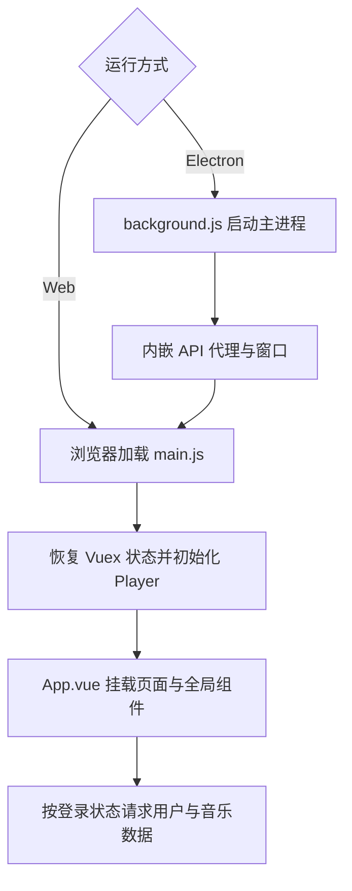

# YesPlayMusic 项目结构与执行流程参考

[文档导航](./README.md) · [听潮架构](./架构总览.md)

本文分析的是参考项目 [YesPlayMusic](https://github.com/qier222/YesPlayMusic)，
用于解释听潮借鉴了哪些设计。它不是听潮的运行说明或功能清单。

分析基于本地源码快照，`package.json` 版本为 0.4.10，使用 Vue 2、Vuex、Vue CLI
与 Electron；该快照未记录 Git 提交 SHA，不能据此判断上游最新版的行为。
本文保留与听潮有关的结构和流程，省略重复的函数、IPC 通道和平台打包细节枚举。

## 参考项目结构

以下路径都属于 YesPlayMusic，不是本仓库的同名文件：

```text
src/
├── main.js              # Vue 渲染进程入口
├── App.vue              # 导航、页面、播放器与全局交互
├── background.js        # Electron 主进程入口
├── api/                 # 歌曲、歌单、用户、专辑、歌手、MV 等请求
├── components/          # 可复用的内容与播放组件
├── views/               # 首页、发现、音乐库、详情、搜索、设置等
├── store/               # Vuex 状态、mutation、action 与持久化插件
├── utils/
│   ├── Player.js        # 音频、队列、循环、播放事件
│   ├── request.js       # 按运行环境选择 API 地址
│   ├── db.js            # IndexedDB 数据与音频缓存
│   └── lyrics.js        # 歌词解析与翻译匹配
├── electron/            # IPC、托盘、菜单、快捷键、平台集成
└── ncmModDef.js         # 内嵌 API 的模块映射
```

## Web 与 Electron 两种运行方式

| 方面         | Web                                    | Electron                          |
| ------------ | -------------------------------------- | --------------------------------- |
| 页面启动     | 浏览器加载 Vue 应用                    | 主进程创建窗口，再加载渲染进程    |
| API 来源     | 外部网易云 API                         | 主进程启动内嵌 API 与代理         |
| 路由         | Web History 模式                       | 桌面 Hash 模式                    |
| 原生能力     | 浏览器提供的 API                       | IPC、托盘、窗口菜单、系统快捷键等 |
| 音频文件缓存 | 此快照的 `cacheTrackSource()` 直接返回 | 下载 ArrayBuffer 并写入 IndexedDB |

参考项目也使用浏览器能力，例如 Media Session；不能将所有播放相关能力都归为 Electron 专属。
音频文件缓存则有明确的 `IS_ELECTRON` 条件，旧版文档中“Web 也缓存音频文件”的表述不适用于该快照。

## 启动链路



`main.js` 注册路由、状态、语言和样式；`App.vue` 负责全局页面框架。
Vuex 的 localStorage 插件持久化设置和用户数据，Electron 相关插件通过 IPC
向主进程同步设置。Web 部分不需要启动 Electron 主进程。

## 播放链路

1. 页面根据歌单、专辑或曲目调用 `Player` 方法，设置播放队列。
2. 请求歌曲详情，读取缓存和接口返回的权限信息。
3. 获取音频源，交给 Howler 创建和控制音频实例。
4. 音频事件更新播放状态，定时同步进度与歌词。
5. 切歌或满足上报条件时处理听歌记录；桌面模式还可能更新托盘等信息。

播放器状态集中于 `src/utils/Player.js`，界面组件调用播放器而不各自维护音频实例。
请求封装按运行环境选择 API 地址；多种音频源和原生集成逻辑属于参考项目范围，
不能直接套入听潮的 Vercel Web 部署。

## 借鉴点与听潮对应实现

| 参考项目思路         | 听潮实现                                           | 当前边界                                 |
| -------------------- | -------------------------------------------------- | ---------------------------------------- |
| 集中式播放器         | [player Store](../src/stores/player.js) + Howler   | 网页播放，没有主进程与系统托盘           |
| API 按业务拆分       | [src/api/](../src/api/)                            | 只接入当前页面需要的接口                 |
| 歌曲可播放性映射     | [common.js](../src/utils/common.js)                | 根据权限字段和试听响应处理               |
| 歌词解析与翻译匹配   | [music Store](../src/stores/music.js)              | LRC 行级歌词，未实现逐字歌词             |
| IndexedDB 持久化     | [db.js](../src/utils/db.js)                        | 六张表，TTL + LRU；只缓存 URL 和业务数据 |
| 设置持久化           | [constants.js](../src/constants.js) 与 composables | 浏览器偏好，不是系统级快捷键             |
| 列表与卡片复用       | [components/](../src/components/)                  | 桌面网页布局                             |
| 用户音乐数据集中管理 | `user` 与 `music` Store                            | 没有云盘、MV、Last.fm 等完整扩展能力     |

这是按项目规模重新组织的实现，不是把 Vue 2、Vuex 或 Electron 文件直接替换成 Vue 3。
缓存刷新策略、Store 拆分和同域部署应继续以听潮源码为准。

## 配置与端口的区别

| 配置或端口      | 参考快照                     | 听潮                   |
| --------------- | ---------------------------- | ---------------------- |
| 构建工具        | Vue CLI                      | Vite                   |
| API 环境变量    | `VUE_APP_NETEASE_API_URL` 等 | `VITE_NETEASE_API_URL` |
| 本地前端端口    | 默认 8080                    | 默认 5173              |
| 外部 API 端口   | Web 开发默认 3000            | 本地默认 3000          |
| 内嵌 API 与代理 | Electron 中的 10754 / 27232  | 无此桌面运行链路       |
| 生产 API        | 随 Web 或 Electron 配置      | Vercel 同域 `/api/*`   |

参考项目中的 `src/store/`、`vue.config.js`、`background.js` 和 `VUE_APP_*`
不能当成听潮的安装步骤。使用本项目应从[根 README](../README.md)开始。

## 使用参考分析时

- 先确认讨论的是哪个仓库、哪个源码版本和哪种运行环境。
- 追踪入口、状态、请求和缓存，避免仅因函数名相同就认为行为一致。
- 借鉴前检查浏览器与桌面进程的依赖边界。
- 引用代码和设计时保留项目来源；新增能力的状态写入听潮待办，而非假定已经移植。

[返回文档导航](./README.md)
