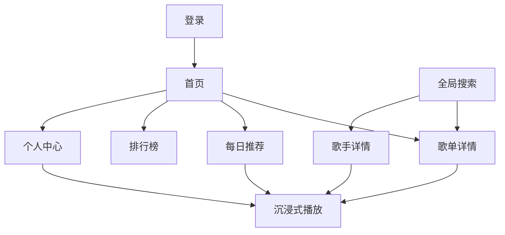

# 听潮功能设计说明书

[文档导航](./README.md) · [需求规格](./需求规格说明书.md) · [架构总览](./架构总览.md)

本文解释当前页面如何连接状态和接口，重点说明用户操作、数据去向和实现边界。
对应需求采用 `FUN-*` 编号；技术分层与缓存参数见架构文档，视觉规范见 [UI 设计](./UI设计方案.md)。

## 页面与用户路径

登录以外的路由均要求登录。导航和全局搜索连接多个页面，
底部播放栏共用 `player` Store，离开播放页不创建另一份播放器。
路由配置见 [src/router/index.js](../src/router/index.js)。

## 用户认证（FUN-USER）

入口：[LoginView.vue](../src/views/LoginView.vue)。

界面有扫码与账号两种模式；账号模式内部切换密码和验证码。
密码与验证码登录都提交到 `/login/cellphone`，验证码由 `/captcha/sent` 发送。

| 流程       | 行为                                                                                          |
| ---------- | --------------------------------------------------------------------------------------------- |
| 密码登录   | 校验账号 4–16 字符、密码 6–20 字符，再交由服务端校验手机号和凭证                              |
| 验证码登录 | 校验账号与 4–6 位数字验证码；发送成功后开始 60 秒倒计时                                       |
| 扫码登录   | 请求 key，前端 `qrcode` 生成二维码，每 1 秒检查状态；成功后设置 Cookie 并读取 `/user/account` |
| 登录完成   | 更新 `user` Store，持久化用户与喜欢 ID，返回 `redirect` 或首页                                |
| 退出登录   | 确认后立即清理用户本地状态和音频 URL 缓存，后台请求登出并跳登录页                             |

退出登录不会清空所有浏览器数据。当前没有注册和邮箱登录入口，
也不应将前端登录标记描述为服务端权限校验。

## 音乐发现与搜索（FUN-RECOMMEND）

### 首页、每日推荐和榜单

- [HomeView.vue](../src/views/HomeView.vue) 展示推荐歌单，分类来自 `/playlist/catlist`，切换后请求对应分类歌单。
- [DailyRecommendView.vue](../src/views/DailyRecommendView.vue) 区分推荐歌曲与歌单，使用登录账号相关接口。
- [ToplistView.vue](../src/views/ToplistView.vue) 展示榜单与前三首预览，播放时取完整歌单详情，预览数量不限制实际播放列表。

页面通过 `music` Store 管理数据，卡片和歌曲表格复用组件。
推荐、分类和榜单接入持久缓存；每日推荐另有内存时间判断，
不能据此宣称所有推荐结果都长期离线可用。

### 全局搜索

[NavBar.vue](../src/components/NavBar.vue) 输入关键词，
[music Store](../src/stores/music.js) 按类型请求 `/search`，
[SearchResultsOverlay.vue](../src/components/SearchResultsOverlay.vue) 展示结果。

| 类型 | 参数 `type` | 点击行为               |
| ---- | ----------- | ---------------------- |
| 单曲 | 1           | 进入播放流程           |
| 歌单 | 1000        | 打开歌单详情           |
| 歌手 | 100         | 关闭搜索并打开歌手详情 |
| 专辑 | 10          | 提示尚不支持专辑详情   |

切换路由或关闭覆盖层会清空搜索状态。歌曲搜索结果也经过可播放状态映射，
不是只在首页对现有列表做本地筛选。

### 歌手详情

[ArtistView.vue](../src/views/ArtistView.vue) 将 `/artists` 与 `/artist/desc`
合并为头部信息和热门曲目，另用 `/artist/songs`、`/artist/album` 分页。
全部歌曲和专辑通过滚动哨兵继续加载；专辑失败提供点击重试。
“播放热门”使用热门曲目列表，专辑卡片目前只展示名称、封面与年份。

## 播放与歌词（FUN-PLAYER）

[player Store](../src/stores/player.js) 负责曲目与 Howler 实例，
[PlayerBar.vue](../src/components/PlayerBar.vue) 和
[PlayerView.vue](../src/views/PlayerView.vue) 共享操作入口。

1. 播放操作设置队列和当前索引，请求歌曲详情及播放 URL。
2. 创建 `Howl`，加载后读取实际时长并按操作播放。
3. 定时读取进度，通过 `ProgressBar` 支持跳转。
4. 曲目结束按循环与随机状态切换；切歌上报上一首听歌时长。
5. 音频加载失败清除 URL 缓存并重取一次，避免无限重试。

[common.js](../src/utils/common.js) 根据权限附加 `playable` 与 `reason`。
需要 VIP 的曲目可能提供试听；播放器展示试听提示，实际时长按 Howler 结果显示。

歌词由 `/lyric` 返回，`parseLRC()` 解析原文和翻译，按 `rawTime` 匹配。
播放页依据进度高亮并滚动，也支持点击歌词跳转。
字号、翻译和时间显示偏好按设置页提示重新进入播放页后生效。

## 歌单与个人中心（FUN-USERCENTER）

### 歌单详情

[PlaylistView.vue](../src/views/PlaylistView.vue) 请求 `/playlist/detail`，
用 `tracks` 首批展示；若 `trackCount` 大于已加载数量，再由 `trackIds` 请求歌曲详情。
曲目逐批补齐，不能把详情返回的首批 `tracks` 当成完整歌单。

操作包括播放、评论与分享。自己的歌单提供移除操作，
目前更新当前列表、缓存和本地歌单记录，没有请求服务端删除歌曲。

### 创建与添加

[ProfileView.vue](../src/views/ProfileView.vue) 提供新建歌单表单。
Store 请求 `/playlist/create` 后保存本地记录；名称和隐私参数提交服务端，
简介仅保存在本地。当前没有歌单编辑与删除的界面入口。

[AddToPlaylistModal.vue](../src/components/AddToPlaylistModal.vue) 区分两个目标：

| 目标       | 写入方式                                          | 边界                       |
| ---------- | ------------------------------------------------- | -------------------------- |
| 本地歌单   | `musicStore.addTrackToPlaylist()` 与 localStorage | 不同步到网易云             |
| 网易云歌单 | `/playlist/tracks`，`op: add`                     | 以服务端响应和账号权限为准 |

因此同一个歌单的本地副本与服务端内容可能不同。
创建后已有列表的缓存也可能暂未刷新，不能把本地提示当作所有页面立即同步的保证。

### 个人中心

侧栏提供喜欢、歌单、历史、设置四项：

- 喜欢列表先取 ID，再取歌曲详情；喜欢 / 取消喜欢会发起 `/like` 请求。
- 歌单按创建者区分自己创建和账号已有收藏，当前没有新增收藏操作。
- 历史区分本地、最近一周和全部时间；清空按钮只清理本地历史。
- 设置管理主题、主题色、VIP 角标显隐、音质、歌词、快捷键和预加载。

资料显示来自登录响应；昵称和头像修改函数仍保留，但设置页没有编辑入口。

## 评论、弹窗与反馈（FUN-COMMON）

| 组件                                                         | 行为                                                 |
| ------------------------------------------------------------ | ---------------------------------------------------- |
| [CommentModal](../src/components/CommentModal.vue)           | 请求歌曲或歌单评论，首页缓存，追加页走网络；只读展示 |
| [TrackDetailModal](../src/components/TrackDetailModal.vue)   | 展示歌曲信息及相关操作                               |
| [PlaylistPanel](../src/components/PlaylistPanel.vue)         | 当前播放队列、切换与移除曲目                         |
| [ConfirmDialog](../src/components/ConfirmDialog.vue)         | 通过 `ui.showConfirm()` 的 Promise 返回确认或取消    |
| [ToastNotification](../src/components/ToastNotification.vue) | 成功、警告或错误反馈，默认 2 秒移除                  |

多个弹窗复用 ESC 关闭能力。取消确认只关闭弹窗，不执行待确认操作。

## 本地数据与服务端数据的维护边界

| 数据                           | 来源与生命周期                              |
| ------------------------------ | ------------------------------------------- |
| 登录标记、用户资料、喜欢 ID    | 登录和账号接口，部分保存 localStorage       |
| 播放状态、偏好、本地历史和歌单 | 当前浏览器持久化，不代表跨设备同步          |
| 歌曲、歌词、歌单详情等缓存     | IndexedDB，TTL 与 LRU；详见架构文档         |
| 账号歌单、每日推荐、服务端历史 | 网易云接口，可能因账号、会话或上游规则变化  |
| 音频                           | 从响应 URL 播放，只缓存 URL，不保存音频文件 |

验证流程见[需求验收清单](./需求规格说明书.md#验收清单)。
尚未完成的入口、同步边界和接口问题见[功能状态与待办](./VMusic待办事项清单.md)。

[返回文档导航](./README.md)
