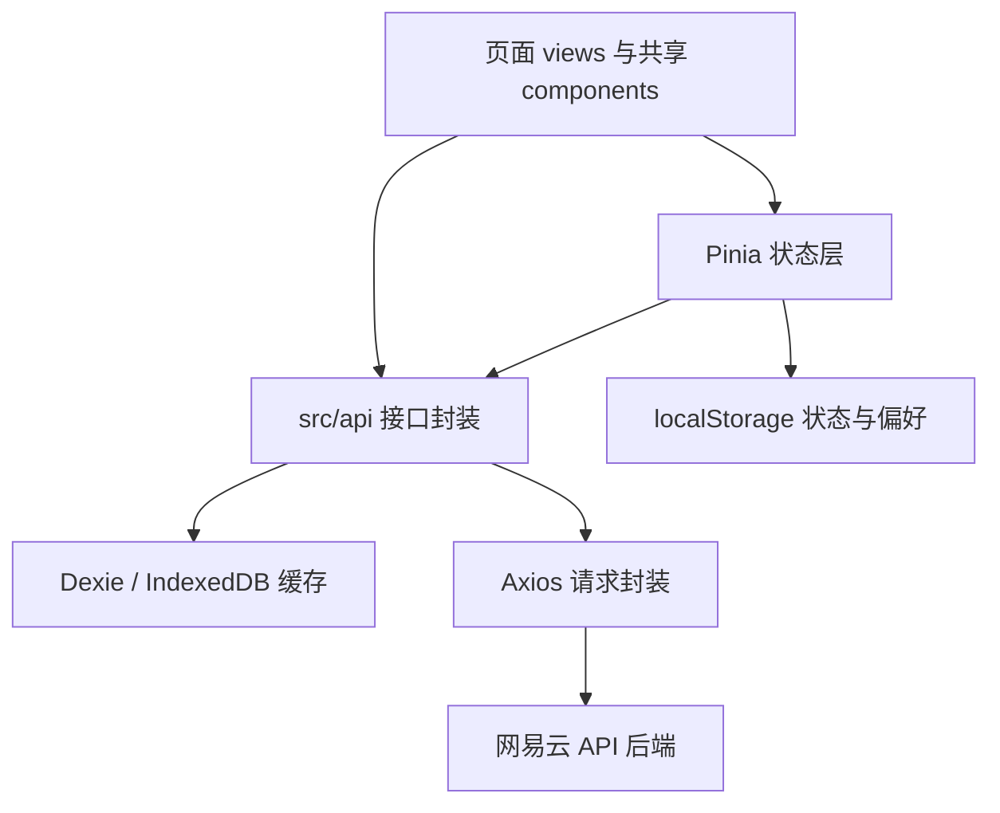
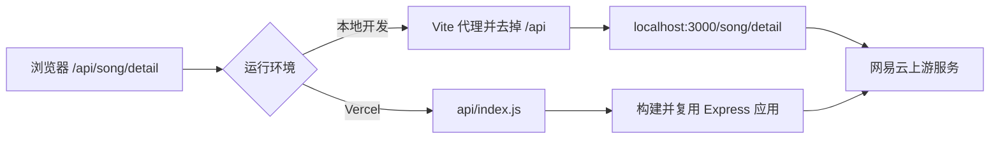
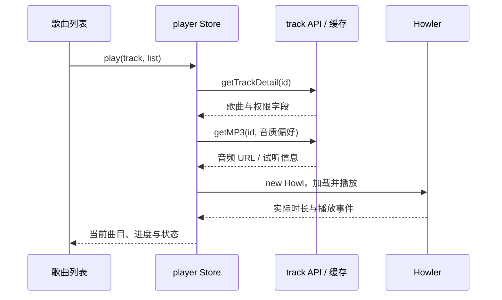

# 听潮架构总览

[文档导航](./README.md) · [功能设计](./功能设计说明书.md) · [接口数据](./网易云后端返回数据分析.md)

本文描述当前仓库的代码组织、执行链路与持久化边界。
源码使用 Vue 3 的 Composition API，根组件连接页面、播放栏和全局弹窗。

## 代码分层

| 目录或文件                                      | 职责                                                 |
| ----------------------------------------------- | ---------------------------------------------------- |
| [src/main.js](../src/main.js)                   | 创建 Vue 应用，注册 Pinia 与路由，引入全局样式       |
| [src/App.vue](../src/App.vue)                   | 全局组件、状态恢复、登录后预加载与页面过渡           |
| [src/router/index.js](../src/router/index.js)   | 懒加载页面、登录守卫、标题与滚动行为                 |
| [src/stores/](../src/stores/)                   | 按用户、播放、内容、界面拆分状态                     |
| [src/api/](../src/api/)                         | 认证、用户、歌曲、歌单、歌手、搜索接口及部分缓存接入 |
| [src/utils/request.js](../src/utils/request.js) | Axios 实例、API 基地址、凭证和响应处理               |
| [src/utils/db.js](../src/utils/db.js)           | IndexedDB 表、缓存读写、过期判断与 LRU 淘汰          |
| [src/utils/common.js](../src/utils/common.js)   | 可播放性映射、歌词解析、图片和时间处理               |
| [src/composables/](../src/composables/)         | 主题、快捷键、预加载、ESC 关闭                       |
| [src/constants.js](../src/constants.js)         | 存储键、默认值、缓存参数与轮询间隔                   |

## 部署与请求链路

开发代理由 [vite.config.js](../vite.config.js) 配置。
前端的 `VITE_NETEASE_API_URL` 默认是 `/api`，Axios 使用 `withCredentials: true`，
成功响应返回 `response.data`，失败响应仍会拒绝 Promise。
遇到特定的登录过期响应只在控制台提示，不会由请求拦截器自动完成重新登录。

生产配置见 [vercel.json](../vercel.json)：

| 设置                        | 当前值或行为                                                           |
| --------------------------- | ---------------------------------------------------------------------- |
| 安装依赖                    | `npm ci && npm install --prefix NeteaseCloudMusicApi --omit=dev`       |
| 构建 / 输出                 | `npm run build` / `dist/`                                              |
| API 入口                    | [api/index.js](../api/index.js) 去掉 `/api` 前缀，将请求交给仓库内后端 |
| 函数资源                    | 显式包含后端的 `module`、`util`、`plugins`、`data`                     |
| 页面路由                    | 非 API 页面路径回退至 `index.html`，支持 History 路由刷新              |
| 函数区域 / 最长执行时间配置 | `hkg1` / 60 秒                                                         |

`api/index.js` 以 Promise 复用一次初始化的 Express 应用。
后端说明图片和演示页面已从仓库移除，不是函数运行的依赖。
平台 Node.js 设置参考 [Vercel 官方文档](https://vercel.com/docs/functions/runtimes/node-js/node-js-versions)。

## 启动和登录恢复

1. `main.js` 注册 Pinia、Router 并挂载 `App.vue`。
2. 路由守卫首次调用 `userStore.restore()`，从本地记录恢复登录标记。
3. `App.vue` 挂载后恢复用户、播放器、本地歌单和分类状态，并请求喜欢的歌曲 ID。
4. 登录状态从无到有时按设置执行预加载；总开关默认关闭。
5. 登录后显示导航栏；有当前曲目时显示播放栏。进入播放页隐藏导航栏。

本地登录标记用于页面访问控制，不等于服务端 Cookie 永久有效。
重新访问受保护页面时，账号接口仍可能返回需要登录。

## 页面路由

当前有 8 个页面路由，除登录页外均要求登录：

| 路径               | 视图                     | 用途                         |
| ------------------ | ------------------------ | ---------------------------- |
| `/login`           | `LoginView.vue`          | 扫码、手机号密码或验证码登录 |
| `/`                | `HomeView.vue`           | 推荐歌单与分类浏览           |
| `/player/:id`      | `PlayerView.vue`         | 沉浸式播放与歌词             |
| `/playlist/:id`    | `PlaylistView.vue`       | 歌单详情、歌曲与评论         |
| `/profile`         | `ProfileView.vue`        | 喜欢、歌单、历史与偏好设置   |
| `/daily-recommend` | `DailyRecommendView.vue` | 推荐歌曲与歌单               |
| `/toplist`         | `ToplistView.vue`        | 排行榜浏览                   |
| `/artist/:id`      | `ArtistView.vue`         | 歌手介绍、歌曲与专辑列表     |

未登录访问受保护页面时跳转 `/login?redirect=原路径`，登录后回跳。
已登录访问登录页则跳首页。返回导航恢复已保存的滚动位置，新导航回到顶部。

## 状态管理与持久化

| Store    | 职责                                                         | 持久化方式                                                  |
| -------- | ------------------------------------------------------------ | ----------------------------------------------------------- |
| `user`   | 登录标记、资料、喜欢的歌曲 ID 与详情                         | 用户信息与 ID 集合存 localStorage；详情在内存中             |
| `player` | 曲目、队列、播放状态、进度、音量、循环、随机、本地历史       | 播放状态延迟写 localStorage；历史单独保存                   |
| `music`  | 推荐、分类、搜索、歌词、本地歌单、每日推荐、榜单、服务端历史 | 本地歌单与分类存 localStorage；部分接口和歌词接入 IndexedDB |
| `ui`     | 确认弹窗与 Toast                                             | 内存瞬时状态                                                |

播放器状态统一由 `player` 管理，各页面和播放栏共享同一份状态。
存储键集中在 `STORAGE_KEYS`，沿用 `vmusic-` 前缀以兼容已有浏览器数据。
退出登录会清理用户状态和音频 URL 缓存，不会清空所有数据库与个人偏好。

## 播放一首歌

切歌前上报上一首听歌时长，新曲目写入本地历史。
`mapTrackPlayableStatus()` 给列表附加 `playable` 和 `reason`，
无版权或需购买的歌曲被限制；需 VIP 的歌曲仍可尝试上游提供的试听片段。

播放进度每 250ms 读取一次 Howler；播放页每 100ms 根据进度计算歌词高亮行。
原文与翻译歌词由 `music.fetchLyrics()` 解析并匹配时间标签。
试听片段使用 Howler 实际时长，避免误用完整歌曲的元数据时长。

音频加载失败时清除该歌曲 URL 缓存并重取一次，第二次失败后停止重试。
应用只保存临时音频 URL，不缓存音频文件，也不提供离线播放。

## IndexedDB 缓存

数据库名为 `vmusic`，当前 schema 为 version 2，共 6 张表：

| 表               | 数据                                 | TTL         | 条数上限 |
| ---------------- | ------------------------------------ | ----------- | -------- |
| `lyric`          | 解析后的原文与翻译歌词               | 7 天        | 500      |
| `trackDetail`    | 歌曲与权限                           | 1 天        | 500      |
| `playlistDetail` | 歌单与歌曲                           | 1 小时      | 100      |
| `trackSource`    | 音频 URL 和码率                      | 30 分钟     | 200      |
| `userPlaylists`  | 按用户 ID 保存歌单列表               | 10 分钟     | 5        |
| `miscCache`      | 榜单、分类、推荐、评论首页、歌手详情 | 按 key 决定 | 20       |

`miscCache` 中榜单和分类为 1 天、推荐为 1 小时；评论首页与歌手详情
使用默认 1 小时。评论追加页、歌手歌曲与专辑分页走网络。

缓存读取有三种情况：未过期直接返回；过期先返回旧值并在后台更新；
未命中等待网络。后台写入缓存不保证所有已挂载页面立即重新渲染。
读取更新 `lastAccess`，写入超出条数上限时淘汰最少访问记录。
它限制的是记录数量，不是浏览器存储字节配额。

`getPlaylistDetail(id, true)` 可以跳过缓存主动请求。
切换音质清空音频 URL 缓存，下一次播放按新偏好请求。

## 维护时的关键约束

- 每个视图保持单根节点，配合根组件的 `fade`、`out-in` 过渡。
- 导入别名 `@` 对应 `src/`，配置见 Vite 与 `jsconfig.json`。
- 新增歌曲列表接口时接入 `mapTrackPlayableStatus()`，保持列表权限行为一致。
- 缓存、默认值和存储键优先使用 `constants.js`，不另建相同用途的缓存层。
- 修改播放器时保留音频 URL 失效后的单次重试逻辑。
- 代码风格以 [.prettierrc.json](../.prettierrc.json) 为准，当前行宽为 80。

[返回文档导航](./README.md)
